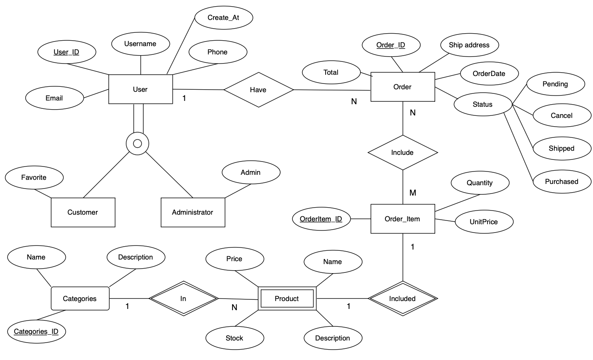
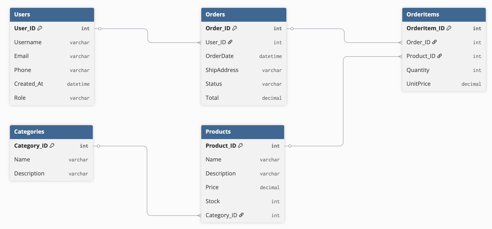

# BinhTinhStore — E-commerce Database Management System

BinhTinhStore is a full-stack academic project that explores how an e-commerce
application can use both a relational database and a document database. The
application combines a React storefront and admin interface with an Express API,
SQL Server for transactional business data, and MongoDB for document-oriented
features and DBMS demonstrations.

> **Project context:** This was developed as a team project for a Database
> Management Systems course. My primary contribution focused on **transaction
> processing and the Order API**, including order creation, inventory updates,
> cancellation flows, and rollback behavior.

## Highlights

- Full customer flow: authentication, product pages, accent-insensitive search
  across the whole catalog, a cart saved on the server for signed-in users,
  checkout with a validated Vietnamese shipping address, order history and
  detail pages, cancellation, reviews, vouchers, and VNPay sandbox integration.
- Build PC with compatibility checks (socket, RAM type and slots, M.2 slots,
  form factor, GPU length, cooler height, PSU headroom), suggested builds by
  the software a customer needs (picked from a preset or from a sentence such
  as "code web và Docker, tầm 20 triệu": keywords and budget are parsed on the
  server and the parts and prices always come from stock), upgrade advice for
  an existing PC, and 48-hour price-locked quotes with a shareable link.
- Price history on every product page and warranty lookup by serial number.
- Admin workflows for product, image, order, warranty, user, and analytics management.
  The order list searches by order code, customer or recipient name (without
  accents) and phone, filters by status, and opens an order detail panel with a
  printable delivery slip and the carrier and tracking code.
- Returns: within `RETURN_DAYS` of delivery a customer requests an exchange or
  a refund from the order page. Requested quantities never exceed what was
  bought (the order row is locked, so concurrent requests queue up); the admin
  approves, receives (optionally putting items back on sale), and completes.
  Refunds are capped at what the customer paid; exchanges take the replacement
  from stock. Every step is in the stock ledger and notifies the customer.
- Stock receipts from suppliers and a stock ledger: every stock change (receipt,
  sale, cancellation, manual adjustment, returned item, exchange) is recorded with the resulting stock,
  plus a daily report split by Vietnam time with CSV export.
- Time-limited Hot Deals: start and end times, a number of deal units and a
  per-order limit. The server applies the deal price when quoting and when
  creating an order, locks the deal row so two buyers cannot take the last
  unit, gives the unit back when an order is cancelled, and refuses an order
  (409) when the total changed after the customer saw it.
- After-sales services: book a technician at home (time slots with a per-slot
  capacity, locked so two bookings cannot overbook a slot), a trade-in
  estimate and request, and warranty claims for the customer's own serial
  numbers, each with a status timeline the customer can follow and the admin
  updates.
- Price watch and in-account notifications: a customer can watch a product
  (optionally with a target price) and gets a notification when the price, or
  a running Hot Deal, drops below it; order status changes and service
  request updates also notify the customer (bell in the header). A sold-out
  product has "Báo tôi khi có hàng": when stock comes back (a receipt, a
  cancelled order, a restocked return) the customer is notified once.
- Product Q&A: signed-in customers ask about a product, the store answers and
  the answer is published under the question with the asker's given name only;
  the asker is notified. Unanswered questions are visible only to the asker.
- Review moderation: reviews come only from customers who received the product.
  The store can reply publicly under a review, and can hide a review only for
  one of four stated reasons (spam, offensive language, personal information,
  off topic); hidden reviews are not shown and not counted in the star rating,
  and the author is told why. The admin to-do list counts 1-2 star reviews
  still waiting for a reply.
- Favorites (`#/yeu-thich`) with current price and stock, recently viewed
  products, and a page that recovers by itself when a new version is deployed
  while a tab is open (no blank screen).
- SQL Server transactions for order creation and cancellation.
- Row-level locking with `UPDLOCK` and `ROWLOCK` to protect inventory during
  concurrent orders.
- `COMMIT`/`ROLLBACK` handling to preserve consistency when a multi-step order
  operation fails.
- MongoDB models and scripts demonstrating indexing, query processing,
  transactions, concurrency control, backup, and recovery concepts.
- Reproducible local database environment using Docker Compose.

## Architecture

```text
React + Vite client
        │
        │ REST API / JWT
        ▼
Node.js + Express server
        ├── SQL Server: users, products, inventory, orders, vouchers
        └── MongoDB: reviews, product logs, and DBMS demonstrations
```

### Repository structure

```text
.
├── backend-app/       # Express API, authentication, services, routes
├── frontend-app/      # React + Vite customer and admin interfaces
├── database/          # SQL Server migrations and seed data
├── database-demo/     # SQL Server and MongoDB DBMS demonstrations
├── dbms-env/          # Docker Compose services
└── docs/              # ERD and schema documentation
```

## Database design

### SQL Server ERD



The relational model covers users, categories, products, orders, order items,
vouchers, and voucher usage. Migration scripts live in
[`database/migrations`](database/migrations).

### MongoDB schema



MongoDB is used for product logs and reviews, with additional scripts under
[`database-demo/mongo_db_demo`](database-demo/mongo_db_demo) to demonstrate
indexing, query processing, transactions, and concurrency behavior.

## Money handling

- Shipping fee, automatic discounts and voucher discounts are computed only on the
  server (`backend-app/src/services/pricing.service.js`). Any `discount`,
  `shippingFee` or `total` sent by the client is ignored.
- Vouchers are locked with `UPDLOCK` and recorded in `VoucherUsages` inside the
  same transaction as the order, so a voucher's last use cannot be taken twice.
- VNPay IPN checks the signature, compares `vnp_Amount` with the order total and
  ignores repeated callbacks. A failed payment or an unpaid order older than
  `PAYMENT_EXPIRE_MINUTES` is cancelled and its stock and voucher use are released.
- The VNPay return page only displays the stored status in production. In
  development it records the result with the same logic as the IPN, because the
  sandbox cannot call an IPN URL on `localhost` (`VNPAY_UPDATE_ON_RETURN`).

## Storefront pages

The React app uses hash routes so it needs no router library or server rewrite rules:

| Route | Page |
| --- | --- |
| `#/san-pham/:id` | Product detail (specs, stock, reviews from MongoDB) |
| `#/tim-kiem?q=` | Search results with sorting and pagination |
| `#/thanh-toan` | Checkout: shipping address, payment method, voucher |
| `#/don-hang` | Order history |
| `#/don-hang/:id` | Order detail: cancel, retry VNPay payment, carrier and tracking code, warranty serials, return requests |
| `#/build-pc` | Build PC: pick parts, compatibility check, suggested builds, upgrade advice, save a quote |
| `#/bao-gia/:code` | Shared quote: quoted vs current price, buy at the locked price |
| `#/bao-hanh` | Warranty lookup by serial; the signed-in customer's warranties, warranty claims and repair history |
| `#/dich-vu/:tab` | After-sales services: technician at home (`tai-nha`), trade-in (`thu-cu`), my requests (`cua-toi`) |
| `#/tai-khoan` | Account: change password, download personal data, delete account |
| `#/so-sanh?ids=1,2,3` | Compare up to 3 products side by side; parts of the same type get their Build PC specs (VRAM, socket, length…) |
| `#/yeu-thich` | Favorite products saved in this browser, with current price and stock |
| `#/chinh-sach/:slug` | Purchase terms, shipping, payment, returns, warranty, complaints, seller information |
| `#/chinh-sach-bao-mat` | Privacy policy |

Search matches Vietnamese text without accents ("man hinh" finds "Màn hình").
Each product stores a folded `SearchText` column (migration `006`); the API
fills it on startup for existing rows and whenever a product is created or
edited.

Build PC data lives in `ComponentSpecs` (migration `007`, sample parts in
`database/seeds/003_seed_components.sql`; specs and prices there are sample
values for the demo). Compatibility rules are pure functions in
`backend-app/src/utils/compatibility.js`, so they are unit tested without a
database. A saved quote keeps each part's price for 48 hours
(`QUOTE_VALID_HOURS`): the order uses the lower of the quoted and current
price, and an expired quote is reported to the customer instead of silently
charging a different amount. Price history is written in the same
transaction as the product insert or update made through the API; edits made
directly in SQL bypass it.

Policy pages read their numbers (shipping fee, delivery days, return days,
VNPay time limit, tier discounts) from `GET /store/info`, which serves the same
configuration the API uses to price orders. Seller details come from the
`STORE_*` variables in `backend-app/.env`; until they are set, the footer and
the seller page show "chưa cập nhật". Checkout requires the customer to accept
the purchase terms, and each order stores the accepted terms version.

Shipping addresses follow the two-level administrative units in effect since
1 July 2025 (province/city → ward/commune). The backend validates the address
and phone number for every order.

## Transaction processing

The order service treats checkout as one atomic unit of work:

1. Validate the customer and normalize the requested items.
2. Lock and read each product row before checking stock.
3. Create the order and order-item records.
4. Decrease inventory for every purchased item.
5. Commit only after every step succeeds; otherwise roll back the transaction.

Order cancellation follows the same principle: it locks the order, restores
inventory, updates the status, and commits as one transaction. See
[`backend-app/src/services/order.service.js`](backend-app/src/services/order.service.js)
for the implementation.

### Concurrency control used across the store

Every operation where two requests could race for the same scarce thing takes
a lock inside one transaction, and each has an integration test that fires the
requests at the same time (`npm run test:db`).

| Race | What could go wrong | How it is prevented | Test |
| --- | --- | --- | --- |
| Two orders for the last unit | Stock goes negative, both customers charged | `UPDLOCK, ROWLOCK` on product rows in `ProductID` order, `CHECK (Stock >= 0)` | two orders, last unit → one succeeds |
| Last use of a voucher | Code used beyond its limit | Voucher row locked `UPDLOCK`; usage and `UsedCount` written in the order's transaction | two orders, one use left → one discount |
| Last Hot Deal units | More units sold at the deal price than offered | `PromotionItems` row locked after the product rows; `SoldCount <= QuantityLimit` constraint | five buyers, two units → exactly two |
| Technician time slot | More bookings than technicians | Count of the slot read with `UPDLOCK, HOLDLOCK` (key-range lock) before inserting | many bookings for one slot → capped |
| Return requests | Returning more than was bought | Order row locked `UPDLOCK`; requested quantities summed under the lock | five requests for one item → one accepted |
| Pending product questions | Flooding past the 5-question cap | Pending count read with `UPDLOCK, HOLDLOCK` in the inserting transaction | eight at once → five |
| Supplier receipts | Lost stock updates | Products locked in `ProductID` order (same order as checkout, no deadlock); ledger row per change | many receipts for one product → all counted |
| Account deletion during checkout | An open order on a deleted account | Both lock the `Users` row first | delete and order at once → no open order left |
| VNPay IPN called twice | Order paid or stock restored twice | Order row locked; amount checked; repeated call answers `02` | wrong amount → 04, retry → 02 |
| Price and stock alert sweeps | The same alert sent twice | `UPDATE … OUTPUT INTO` / `DELETE … OUTPUT INTO` and the notification insert in one transaction | sweep twice → one notification |

The stock ledger keeps one more invariant: for every product, the sum of
`StockMovements.Change` equals `Products.Stock`, checked after sales,
cancellations, receipts, adjustments, returns and exchanges in the tests.

## Tech stack

| Layer | Technologies |
| --- | --- |
| Frontend | React 19, Vite, JavaScript, Tailwind CSS |
| Backend | Node.js, Express.js, REST APIs |
| Relational database | SQL Server, `mssql` |
| Document database | MongoDB, Mongoose |
| Authentication and security | JWT, bcrypt, Helmet, rate limiting |
| Tooling | Docker Compose, npm, ESLint |

## Getting started

### Prerequisites

- Node.js 18 or later
- npm 9 or later
- Docker Desktop with Docker Compose

### 1. Configure the environment

Copy the example configuration files:

```bash
cp backend-app/.env.example backend-app/.env
cp frontend-app/.env.example frontend-app/.env
```

On Windows PowerShell:

```powershell
Copy-Item backend-app\.env.example backend-app\.env
Copy-Item frontend-app\.env.example frontend-app\.env
```

The checked-in values are local development examples only. Change the database
passwords and JWT secrets before using the application outside an isolated local
environment. Real VNPay credentials must stay in `backend-app/.env`, which is
ignored by Git.

### 2. Start the databases

```bash
cd dbms-env
docker compose up -d
cd ..
```

Wait for both `sqlserver_dbms` and `mongodb_dbms` to report as healthy.

### 3. Install dependencies

```bash
cd backend-app
npm install
cd ../frontend-app
npm install
cd ..
```

### 4. Create and seed the SQL Server database

```bash
cd backend-app
node run-migration.js
node run-seed.js
node fix-password.js
cd ..
```

`run-migration.js` creates the schema on an empty server. On a database that
already has tables it keeps the data and only applies the newer, re-runnable
migrations. To drop everything and start over, run
`node run-migration.js --reset` (this deletes all data). Run `run-seed.js`
only once on a fresh database; running it again adds duplicate demo orders.

### 5. Run the application

In one terminal:

```bash
cd backend-app
npm run dev
```

In another terminal:

```bash
cd frontend-app
npm run dev
```

Open `http://localhost:5173`. The API health check is available at
`http://localhost:3000/health`.

### Run everything with Docker

`docker-compose.yml` at the repository root runs SQL Server, MongoDB, the API
and the web app (nginx serving the Vite build and proxying `/api`):

```bash
cp .env.docker.example .env      # then set passwords and two long random JWT secrets
docker compose up -d sqlserver mongodb
docker compose run --rm backend node run-migration.js
docker compose run --rm backend node run-seed.js
docker compose up -d --build
```

Open `http://localhost:8080`. The API refuses to start in production mode
without `JWT_ACCESS_SECRET` and `JWT_REFRESH_SECRET`. Uploaded product images
are kept in the `uploads` volume.

### Backups and monitoring

`scripts/backup.sh` backs up the running Docker stack into
`backups/<date-time>/`: a SQL Server `.bak` (checked with `RESTORE
VERIFYONLY`), a MongoDB archive, the uploaded images and a `SHA256SUMS`
file. It keeps the newest 14 backups (`KEEP=...` to change). Run it daily
from cron, for example:

```bash
0 2 * * * cd /path/to/dbms-ecommerce && ./scripts/backup.sh >> backups/backup.log 2>&1
```

Copy `backups/` to another machine or drive as well; a backup on the same
disk does not survive a disk failure. To restore (overwrites all current
data, asks for confirmation, checks the checksums first):

```bash
./scripts/restore.sh backups/20261111-020000
```

`/health` answers while the API process is up; `/health/ready` also checks
SQL Server and MongoDB and returns 503 when one is down. Point an uptime
monitor at `https://<your domain>/health/ready`. Server errors are logged
as one JSON line with an `errorId`; in production the customer only sees
a generic message and that id.

SQL Server runs as Express edition in `docker-compose.yml` (free for
production use, 10 GB per database). The image's default Developer
edition is licensed for development and testing only.

### Continuous integration

`.github/workflows/ci.yml` runs on every push and pull request: backend unit
tests, backend integration tests against fresh SQL Server and MongoDB
containers (schema, sample data, then `npm run test:db`), frontend lint and
build, and a build of both Docker images.

## Demo accounts

After seeding the local database:

| Role | Email | Password |
| --- | --- | --- |
| Admin | `admin@btstore.local` | `password` |
| Customer | `customer@btstore.local` | `password` |

These accounts are synthetic test data and must not be used in production.

## API overview

The API is mounted under `/api/v1` and includes:

- `/auth` — registration, login, token refresh
- `/users` — profile and user management
- `/categories` — category operations
- `/products` — catalog and product management, product Q&A (`/products/:id/questions`, admin `/products/admin/questions`)
- `/cart` — saved cart (`GET`/`PUT /cart`), validation and server-side price quote (`POST /cart/quote`)
- `/locations/provinces` — the 34 provinces and cities used by the address form
- `/builder` — Build PC parts, compatibility check, suggested builds, upgrade advice, price-locked quotes
- `/warranties` — public lookup by serial, the customer's warranties, admin registration
- `/products/:id/price-history` — price changes over the last 180 days
- `/orders` — checkout, order history, status (with carrier and tracking code), cancellation, return requests (`/orders/:id/returns`, admin `/orders/admin/returns`)
- `/payments` — VNPay sandbox flow
- `/reviews` — product reviews from verified buyers, helpful votes, admin moderation (`/reviews/admin`: list, hide with a reason, show again, public reply)
- `/vouchers` — voucher validation; admin create (validated, time-zone aware), list with state and usage, switch off/on
- `/analytics` — admin dashboard numbers and the daily report (`/analytics/daily`)
- `/inventory` — stock receipts, stock ledger, low-stock list (admin)
- `/promotions` — running and upcoming Hot Deals (public), create/list/stop (admin)
- `/services` — home service slots, trade-in estimate, customer service requests, admin processing
- `/notifications` — the customer's notifications, mark as read, price watches, back-in-stock alerts

Detailed request and response examples are documented in
[`backend-app/API_SPEC.md`](backend-app/API_SPEC.md).

## DBMS demonstrations

The [`database-demo`](database-demo) directory contains focused examples for
both SQL Server and MongoDB:

- schema creation and seed data;
- query processing and execution plans;
- indexing;
- transactions and rollback;
- concurrency control;
- backup and recovery.

## Validation

Useful local checks:

```bash
# Backend unit tests (Node's built-in test runner, no database needed)
cd backend-app
npm test

# Backend integration tests against the Docker SQL Server and MongoDB
# (start dbms-env and run the migration + seed steps first)
npm run test:db

# Backend JavaScript syntax
node --check src/app.js

# Frontend lint and production build
cd ../frontend-app
npm run lint
npm run build
```

## Security notes

- Real `.env` files, logs, uploaded files, database files, and build output are
  excluded from version control.
- Credentials in `.env.example`, Docker Compose, seed files, and this README are
  intentionally local demo values—not live secrets.
- Replace all example passwords and JWT secrets before deployment.
- The refresh token lives in an `HttpOnly; SameSite=Strict` cookie scoped to
  `/api/v1/auth` (`Secure` in production), is rotated with a random `jti` on
  every use, and is revoked on logout and password change. Only the
  short-lived access token is kept by the page. If the frontend is served from
  a different origin than the API, list it in `CORS_ORIGINS` so the cookie is
  sent; the default proxy setup needs nothing.
- VNPay credentials are not included in this repository.

## License

This repository is shared as an academic portfolio project. No open-source
license is granted unless one is added explicitly.
